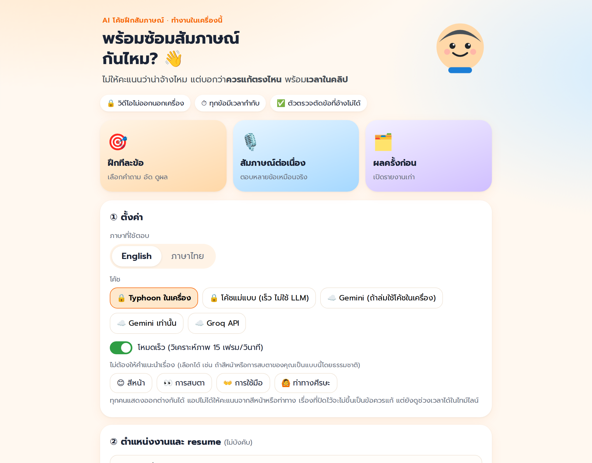
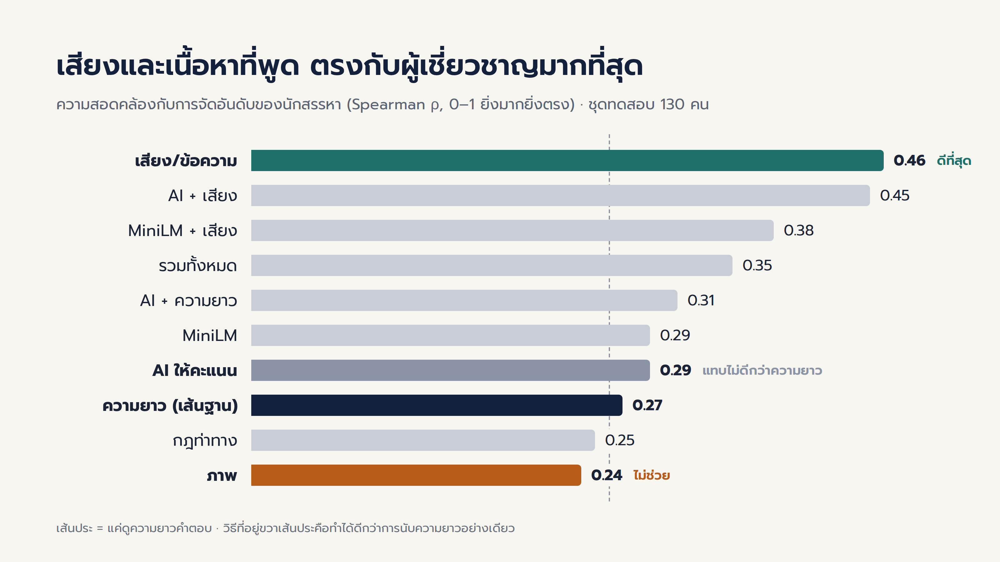
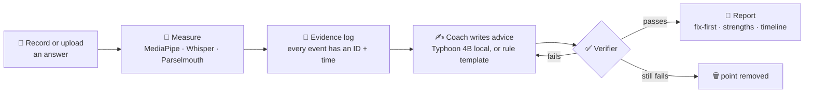
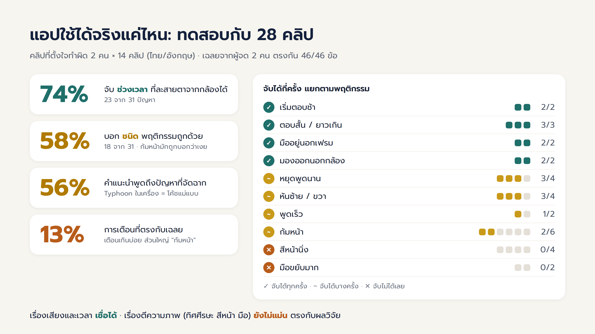

<div align="center">

# 🎤 AI Interview Coach

### A coach that points, not judges

**AI โค้ชฝึกสัมภาษณ์งานที่ตรวจสอบได้** · ไม่ให้คะแนนว่าน่าจ้างไหม แต่บอกว่า *ควรแก้ตรงไหน* พร้อม *เวลาในคลิป*




</div>

---

## What is this?

Practising a video interview alone is hard because nobody tells you **what to fix first**.
Most AI interview tools give a "hireability" score with no reasons, and LLM feedback can
describe things that never happened in the clip.

This project starts from experiments instead of from the app:

1. **Experiment.** On the AVI dataset (real recorded interviews rated by professional
   recruiters), we compare six ways to predict the recruiters' ratings, from "just answer length"
   to "let an LLM score it". The goal is to find what actually carries signal.
2. **Design from the evidence.** Every finding becomes a design rule for the coach.
3. **Test the app.** We run it on 28 staged clips where the right answer is known.

> **One-line pitch:** the app does not tell you how hireable you are. It tells you what to fix,
> at which second, and every point can be checked against measured evidence.

---

## Key findings (RQ1, AVI test set, 130 people)



| Finding | Evidence | Design decision |
|---|---|---|
| 🗣️ **Speech and words carry the signal** | Audio/text features ρ = 0.46, beating answer length (0.27) by +0.19 [0.07, 0.32] | Focus feedback on content and delivery |
| 👀 **Visual features do not help** | Visual alone ρ = 0.24; adding them to audio/text gains nothing (checked on the same 300 people) | Use video only to **point at moments**, never to score |
| 🤖 **An LLM judge mostly follows length** | LLM score adds only +0.04 over length; it tracks word count (ρ 0.46) more than the experts do (0.31) | The LLM **writes** advice from measured evidence; it never scores |
| 📏 **Even the best is only moderate** | ρ ≈ 0.46, close to how much the recruiters themselves agree | **No hire score** in the app |

The ranking holds across five learners (Ridge, ElasticNet, Random Forest, Gradient Boosting, SVR).
Hypotheses were pre-registered, and the test set was opened once.

---

## How the app works



- **Evidence log:** `S` = clip summary, `E` = visual event, `P` = pause, `T` = transcript sentence.
  Each entry has a start and end time, e.g. `[E12] looking away 41–56 s`.
- **Verifier checks** that cited IDs exist, the evidence type matches the claim, times match (±1 s),
  claims don't contradict measured shares, the improved answer invents no numbers, and points
  are not duplicated. A failed point goes back once for revision, then is removed.
- **Coaches:** 🔒 Typhoon 2.5 (Qwen3 4B, Q4_K_M) via Ollama · 🔒 rule template (no LLM) ·
  ☁️ Gemini / Groq (optional, consent required).

### Design principles

| | Principle |
|---|---|
| 1 | **No hire score.** Only broad bands and "start here". |
| 2 | **Content and speech first.** Answer length, slow start, long pauses, pace, STAR structure. |
| 3 | **Video points at moments.** "Looked away 15–25 s", not a visual score. |
| 4 | **The LLM writes, it does not judge.** |
| 5 | **Every point cites evidence.** Unsupported points are cut before you see them. |
| 6 | **Private and respectful.** Videos never leave your computer. You can switch off advice on facial expression, eye contact, gestures or head pose, because people express themselves differently (e.g. autistic candidates). |

---

## Does it work? (RQ2–RQ3, 28 staged clips)



Two speakers × 14 clips (Thai and English) with planned problems. Two annotators labelled them
independently and agreed on 46/46 items.

- ✅ **Speech and timing are reliable:** slow start, too short or long, hands out of frame, look-away.
- ✅ **Look-away moments** are caught 74% of the time (58% when the behaviour type must also be right).
- ⚠️ **Visual interpretation is weak:** head up or down, neutral face and busy hands are often missed,
  and false alarms are common (precision 13%). This matches the RQ1 finding.
- ✍️ **Advice covers 56% of staged problems** with both the local LLM and the rule template.
  Typhoon takes about 5.6 min per clip on a 4 GB GPU laptop.

---

## Quick start

### 1. Requirements

- Python 3.10+ and [FFmpeg](https://ffmpeg.org/) (or the bundled `imageio-ffmpeg`)
- A webcam, for recording in the browser
- *(Recommended)* an NVIDIA GPU with 4 GB or more for WhisperX and the local LLM
- *(For the local coach)* [Ollama](https://ollama.com/)

### 2. Install

```bash
git clone https://github.com/Pooinwuwu/AI_for_Interview.git
cd AI_for_Interview
python -m venv .venv
# Windows: .venv\Scripts\activate   ·   macOS/Linux: source .venv/bin/activate
pip install -r requirements.txt
```

For a CUDA GPU, install the matching PyTorch build first (see [pytorch.org](https://pytorch.org/get-started/locally/)).

### 3. Get the local coach (Typhoon)

```bash
ollama pull hf.co/mradermacher/typhoon2.5-qwen3-4b-i1-GGUF:i1-Q4_K_M
```

Create a `.env` file in the project root:

```ini
LOCAL_LLM_MODEL=hf.co/mradermacher/typhoon2.5-qwen3-4b-i1-GGUF:i1-Q4_K_M
OLLAMA_NUM_CTX=6144
# optional cloud coaches / question generation (need the consent box in the app)
# GEMINI_API_KEY=...
# GEMINI_MODEL=gemini-3.6-flash
# GROQ_API_KEY=...
```

### 4. Run

```bash
python web/server.py        # web app  -> http://127.0.0.1:8000
# or the original Gradio version
python app/app.py           # -> http://127.0.0.1:7860
```

Choose a language and a coach, record an answer, and read the report.
Both servers listen on `127.0.0.1` only.

---

## Project structure

```
AI_for_Interview/
├── web/                    # web app (FastAPI + plain HTML/JS)
├── app/                    # pipeline, report, question generation, Gradio app, LLM writers
├── base/                   # measurement (gaze, head, hands, face, speech), evidence log, dataset loaders
├── approaches/
│   ├── approach_grounded/  # evidence-grounded coach: prompt + verifier
│   ├── approach_template/  # rule-template coach (no LLM)
│   └── scoring_m5_local_llm/  # M5: LLM-as-judge experiment
├── validation/             # RQ1 training, cross-validation, learner check, cross-dataset test
├── scripts/                # 28-clip test runner and evaluation
└── report/                 # aggregate results (CSV / JSON)
```

### Reproduce the research (needs the datasets, see below)

```bash
python validation/cv_score_model.py    --data full --text-emb minilm --llm qwen2.5:3b          # RQ1 cross-validation
python validation/train_score_model.py --data full --text-emb minilm --llm qwen2.5:3b --final  # RQ1 test set (run once)
python validation/cv_learners.py      --data full --text-emb minilm --llm qwen2.5:3b
python scripts/run_test_clips.py && python scripts/eval_test_clips.py    # RQ2-RQ3
```

---

## Data and ethics

- **No interview data is in this repository.** AVI-Personality ([Zhang et al.](https://arxiv.org/abs/2608.25316))
  and RecruitView ([Gupta et al.](https://arxiv.org/abs/2512.00450)) must be requested from their
  authors under their own terms. They were processed only on the researcher's computer.
- **No model trained on these datasets is used in the app.** The app uses the experiments'
  *findings*, not their models.
- **Cloud services (Gemini, Groq) never receive video.** They receive only the transcript and
  measurements, and only after the user ticks the consent box.
- **This is a practice tool, not a hiring tool.** Do not use it to assess or rank candidates.
- Use it only with your own recordings or those of people who agreed to take part.

## Limitations

- **One rated dataset.** RQ1 uses one English dataset (AVI). Findings may differ for Thai interviews.
- **Staged test clips.** The 28 clips come from two speakers, and behaviours are clearer than in real life.
- **Weak visual classifiers.** Head pitch, facial expression and gestures need calibration per camera setup.
- **Only partly human-checked.** Advice was checked for *coverage*; a full human audit of every point is future work.

---

## Built with

[MediaPipe](https://github.com/google-ai-edge/mediapipe) ·
[WhisperX](https://github.com/m-bain/whisperX) ·
[faster-whisper](https://github.com/SYSTRAN/faster-whisper) ·
[PyThaiNLP](https://github.com/PyThaiNLP/pythainlp) ·
[Parselmouth](https://github.com/YannickJadoul/Parselmouth) ·
[Typhoon](https://opentyphoon.ai/) ·
[Ollama](https://ollama.com/) ·
[scikit-learn](https://scikit-learn.org/) ·
[FastAPI](https://fastapi.tiangolo.com/)

## Author

**Jakkarin Kaweepan** · Seminar project, [university / faculty] · Advisor: [advisor name]

<div align="center"><sub>Made in Thailand 🇹🇭 · AI should point at what you can fix, not judge who you are.</sub></div>
